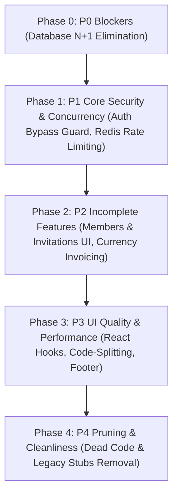

# FlyRank Usage Metering & Billing Engine — Implementation Plan

**Objective:** Detailed, step-by-step roadmap to transform the existing codebase into a verified production-ready system.  
**Execution Rule:** Zero application source code modifications during audit. Execute strictly in prioritized sequence.

---

## 1. Plan Overview & Execution Phases



---

## 2. Phase 0: P0 Application-Breaking Issues

### Task P0.1: Eliminate $O(N)$ Query Amplification in Tenant Controller
- **Problem & Root Cause:** `tenantController.getAllTenants` executes `await meterService.getUsageSummary(row.id)` inside a sequential `for` loop over `result.rows`, issuing 3–4 SQL queries per tenant.
- **Files to Modify:**
  - `src/controllers/tenantController.js` (lines 35–65)
  - `src/controllers/adminController.js` (lines 20–35)
- **Dependencies & Sequence:** Foundation task. Must be completed before adding more UI features.
- **Implementation Strategy:**
  - Replace the loop with a single aggregated SQL query using a `LEFT JOIN` on a subquery aggregating current month usage events and latest invoice total.
  ```sql
  SELECT 
    t.id, t.name, t.email, t.status, t.stripe_customer_id,
    p.name as plan_name, p.api_calls_limit, p.ai_tokens_limit,
    COALESCE(u.monthly_api_calls, 0) as monthly_api_calls,
    COALESCE(u.monthly_ai_tokens, 0) as monthly_ai_tokens,
    COALESCE(u.monthly_events, 0) as monthly_events,
    COALESCE(inv.total_cost_cents, 0) as total_cost_cents
  FROM tenants t
  LEFT JOIN plans p ON t.plan_id = p.id
  LEFT JOIN (
    SELECT 
      tenant_id,
      COUNT(*) as monthly_events,
      SUM(CASE WHEN usage_type = 'api_call' THEN quantity ELSE 0 END) as monthly_api_calls,
      SUM(CASE WHEN usage_type = 'ai_tokens' THEN quantity ELSE 0 END) as monthly_ai_tokens
    FROM usage_events
    WHERE created_at >= DATE_TRUNC('month', CURRENT_DATE)
    GROUP BY tenant_id
  ) u ON t.id = u.tenant_id
  LEFT JOIN (
    SELECT tenant_id, SUM(amount_cents) as total_cost_cents
    FROM invoices
    GROUP BY tenant_id
  ) inv ON t.id = inv.tenant_id
  ```
- **Expected Behavior:** Tenant listings return in a single constant-time ($O(1)$) query under 15ms regardless of tenant count.
- **Test Cases & Acceptance Criteria:**
  - Requesting `GET /api/tenants` with 100 mock tenants in DB completes in < 50ms and issues exactly 1 SQL query.
  - Calculated `monthly_events` and `cost` match individual `getUsageSummary` values.
- **Risk Assessment:** Low. Pure optimization of data access layer; return JSON structure remains identical.

---

## 3. Phase 1: P1 Core Security & Concurrency

### Task P1.1: Guard Test Public Key Auth Bypass
- **Problem & Root Cause:** `src/middleware/auth.js:20-38` checks `process.env.AUTH0_TEST_PUBLIC_KEY` without checking `process.env.NODE_ENV === 'test'`.
- **Files to Modify:**
  - `src/middleware/auth.js` (lines 18–40)
- **Dependencies & Sequence:** Independent. Can execute immediately.
- **Implementation Strategy:**
  - Wrap the test public key check with a strict environment assertion:
  ```javascript
  if (process.env.NODE_ENV === 'test' && process.env.AUTH0_TEST_PUBLIC_KEY) { ... }
  ```
- **Expected Behavior:** In `production` and `development` modes, `AUTH0_TEST_PUBLIC_KEY` is strictly ignored; all tokens are verified exclusively against live Auth0 RS256 JWKS keys.
- **Test Cases & Acceptance Criteria:**
  - With `NODE_ENV=production` and `AUTH0_TEST_PUBLIC_KEY` set, a token signed with the test key is rejected with HTTP 401 Unauthorized.
  - With `NODE_ENV=test`, test key tokens are accepted.
- **Risk Assessment:** Zero risk to production; eliminates critical vulnerability.

### Task P1.2: Distributed Redis Store for Rate Limiting
- **Problem & Root Cause:** `src/middleware/rateLimiter.js:7-46` uses default memory store. Horizontal scaling resets counters per replica.
- **Files to Modify:**
  - `package.json` (add `rate-limit-redis`, `ioredis` as optional/peer dependencies)
  - `src/middleware/rateLimiter.js`
- **Dependencies & Sequence:** Follows P1.1.
- **Implementation Strategy:**
  - Check for `REDIS_URL`. If present, configure `RedisStore` from `rate-limit-redis`.
  - If `REDIS_URL` is omitted, log a warning in production and fall back gracefully to memory store.
- **Expected Behavior:** Clustered instances share a unified rate counter per IP.
- **Test Cases & Acceptance Criteria:**
  - Two parallel requests to different server instances update a shared Redis counter key.
- **Risk Assessment:** Low. Graceful fallback ensures local development runs without Redis requirement.

### Task P1.3: Input Schema Sanitization on Tenant Creation
- **Problem & Root Cause:** `src/controllers/tenantController.js:116-120` reads raw unvalidated body.
- **Files to Modify:**
  - `src/controllers/tenantController.js`
- **Dependencies & Sequence:** Independent.
- **Implementation Strategy:**
  - Implement a lightweight validator asserting `name` (1–100 chars, trimmed, sanitized), `email` (RFC 5322 regex), and `plan` (enum: `'Free'`, `'Pro'`, `'Enterprise'`).
- **Expected Behavior:** Malformed emails or oversized names return HTTP 400 Bad Request with field-specific errors.
- **Test Cases & Acceptance Criteria:**
  - Submitting `email: "invalid-email"` returns `400` with message `"Invalid email address format"`.
- **Risk Assessment:** Low. Rejects only invalid inputs.

---

## 4. Phase 2: P2 Incomplete Features & Reliability

### Task P2.1: Implement Member & Invitation Management UI
- **Problem & Root Cause:** `frontend/src/pages/FramerTenants.jsx` is titled "Tenants & Members" but has no UI for members or invitations, even though backend endpoints and `frontend/src/utils/api.js` methods exist.
- **Files to Modify:**
  - `frontend/src/pages/FramerTenants.jsx`
- **Dependencies & Sequence:** Requires backend routes (already verified).
- **Implementation Strategy:**
  - Add a sub-tab navigation inside `FramerTenants.jsx`: `[ Organizations ]` and `[ Team Members & Roles ]`.
  - In `Team Members & Roles`:
    - Fetch members via `getTenantMembers(activeTenant.id)` and invitations via `getTenantInvitations(activeTenant.id)`.
    - Render a table showing Member Name, Email, Role badge, and Status.
    - Add an "Invite Member" button opening an invitation modal (`email`, role dropdown: `Tenant Owner`, `Billing Manager`, `Developer`, `Viewer`).
    - Add role update and member removal actions with confirmation dialogues.
- **Expected Behavior:** Tenant Owners and Platform Admins can view team members, send expiring invitations, modify roles, and revoke memberships.
- **Test Cases & Acceptance Criteria:**
  - Submitting an invitation sends an invite via API and renders in the "Pending Invitations" list.
  - Changing a member's role calls `PUT /api/tenants/:id/members/:member_id` and updates the badge immediately.
- **Risk Assessment:** Low. Adds new UI view without modifying existing tenant inspection workflows.

### Task P2.2: Tenant Currency Invoicing Alignment
- **Problem & Root Cause:** `src/services/invoiceService.js:297` hardcodes `currency: 'usd'`.
- **Files to Modify:**
  - `src/services/invoiceService.js` (line 297)
- **Dependencies & Sequence:** Follows Phase 0.
- **Implementation Strategy:**
  - Query tenant's currency preference or default to `'usd'`:
  ```javascript
  currency: (tenant.currency || 'usd').toLowerCase()
  ```
- **Expected Behavior:** Stripe invoice items adopt the tenant's configured currency.
- **Test Cases & Acceptance Criteria:**
  - Generating invoice for a tenant with `currency: 'eur'` passes `currency: 'eur'` to `stripe.invoiceItems.create`.
- **Risk Assessment:** Low. Defaults to `'usd'` if currency column is null.

### Task P2.3: Remove Synthetic Mock AI Fallback in Production
- **Problem & Root Cause:** `src/services/aiService.js:226-269` generates dummy completions when API keys are absent.
- **Files to Modify:**
  - `src/services/aiService.js` (lines 18–35, 226–269)
- **Dependencies & Sequence:** Independent.
- **Implementation Strategy:**
  - Restrict `generateLocal()` to `NODE_ENV === 'test' || NODE_ENV === 'development'`.
  - In `production`, throw a 503 error: `"AI provider not configured. Set GEMINI_API_KEY or GROQ_API_KEY."`
- **Expected Behavior:** Clear, fail-fast error rather than fabricated synthetic text.
- **Test Cases & Acceptance Criteria:**
  - Calling `POST /api/generate` in production without keys returns HTTP 503.
- **Risk Assessment:** Low. Eliminates fake responses.

---

## 5. Phase 3: P3 UI Quality, Performance & Polish

### Task P3.1: Resolve React Hook Dependency Warnings
- **Problem & Root Cause:** Oxlint flagged missing dependencies in `FramerUsage.jsx:78`, `FramerHistory.jsx:92`, and `AuthContext.jsx:87`.
- **Files to Modify:**
  - `frontend/src/pages/FramerUsage.jsx`
  - `frontend/src/pages/FramerHistory.jsx`
  - `frontend/src/contexts/AuthContext.jsx`
- **Dependencies & Sequence:** Independent.
- **Implementation Strategy:**
  - Wrap `fetchData`, `fetchBillingData`, and `refreshUser` in `useCallback` with their appropriate dependencies, or include them in `useEffect` dependency arrays.
- **Expected Behavior:** Zero React Hook lint warnings; predictable re-renders.
- **Test Cases & Acceptance Criteria:**
  - `npm --prefix frontend run lint` reports 0 hook warnings.
- **Risk Assessment:** Zero risk.

### Task P3.2: Dynamic Route Code-Splitting in Vite
- **Problem & Root Cause:** `App.jsx` imports all pages synchronously, causing an 803 kB initial bundle.
- **Files to Modify:**
  - `frontend/src/App.jsx`
- **Dependencies & Sequence:** Follows P2.1.
- **Implementation Strategy:**
  - Use `React.lazy()` for dashboard pages:
  ```javascript
  const FramerDashboard = React.lazy(() => import('./pages/FramerDashboard'));
  const FramerTenants = React.lazy(() => import('./pages/FramerTenants'));
  const FramerUsage = React.lazy(() => import('./pages/FramerUsage'));
  const FramerHistory = React.lazy(() => import('./pages/FramerHistory'));
  const FramerSettings = React.lazy(() => import('./pages/FramerSettings'));
  ```
  - Wrap `<Routes>` in `<Suspense fallback={<Spinner />}>`.
- **Expected Behavior:** Initial bundle drops below 300 kB; pages load on demand.
- **Test Cases & Acceptance Criteria:**
  - `npm --prefix frontend run build` outputs chunks < 400 kB with no chunk warning.
- **Risk Assessment:** Zero risk.

---

## 6. Phase 4: P4 Dead Code Pruning

### Task P4.1: Delete Orphaned Components and Files
- **Files to Delete:**
  - `frontend/src/components/Layout.jsx`
  - `frontend/src/components/ui/Badge.jsx`
  - `frontend/src/components/ui/Button.jsx`
  - `frontend/src/components/ui/Card.jsx`
  - `frontend/src/components/ui/Input.jsx`
  - `frontend/src/components/ui/index.js`
  - `frontend/src/pages/Dashboard.jsx`
  - `frontend/src/pages/History.jsx`
  - `frontend/src/pages/Settings.jsx`
  - `frontend/src/pages/Tenants.jsx`
  - `frontend/src/pages/Usage.jsx`
- **Expected Behavior:** Clean project tree with zero dead or duplicated files.
- **Test Cases & Acceptance Criteria:**
  - Frontend build and lint pass with 0 errors.
