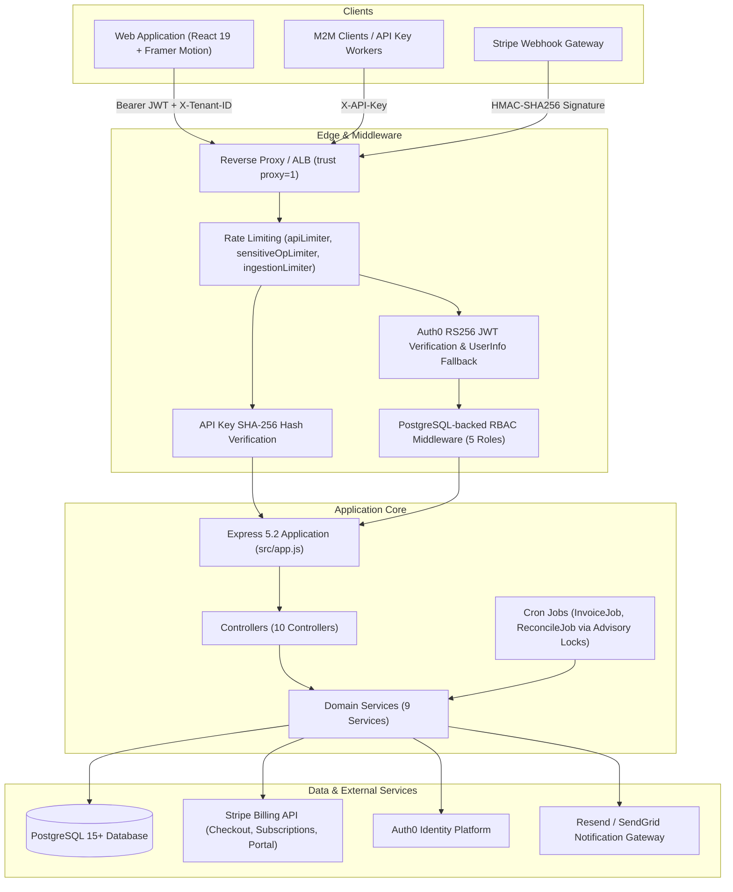

# FlyRank Usage Metering & Billing Engine — Project Map

**Repository:** `flyrank-capstone-metering-billing`  
**Current Audit Date:** 2026-11-22  
**Architectural Baseline:** Multi-tenant SaaS Metering & Billing Engine (Node.js/Express + PostgreSQL + Auth0 + Stripe + React 19 / Vite)

---

## 1. System Architecture & High-Level Topology



---

## 2. Directory Structure & File Inventory

```
usage-metering-billing-engine/
├── .env.example                     # Environment template (Postgres, Auth0, Stripe, AI)
├── docker-compose.yml               # Local development PostgreSQL 15 container (port 5434)
├── docker-compose.test.yml          # Isolated test database container (usage_metering_test)
├── package.json                     # Backend dependencies (Express 5, pg, stripe 22, helmet)
├── schema.sql                       # DDL schema, migrations, constraints & triggers
├── scripts/
│   ├── bootstrap-admin.js           # CLI tool to grant platform admin rights to Auth0 sub
│   ├── init-db.js / .bat / .sh      # Database schema initialization
│   ├── seed-db.js                   # Seed initial plans, mock tenants, and sample metrics
│   └── verify-stripe.js             # Verification utility for Stripe test credentials
├── src/
│   ├── app.js                       # Express app configuration, middleware pipeline & routing
│   ├── server.js                    # Server entrypoint with port binding & cron bootstrap
│   ├── config/
│   │   ├── database.js              # pg.Pool connection pool with DATABASE_URL & SSL
│   │   ├── permissions.js           # RBAC permissions dictionary and 5-role mappings
│   │   └── pricing.js               # Multi-tier pricing calculation engine (API + AI tokens)
│   ├── controllers/
│   │   ├── adminController.js       # Platform-wide metrics, tenant overrides, audit logs
│   │   ├── apiKeyController.js      # Tenant-scoped API key generation, rotation, revocation
│   │   ├── authController.js        # Auth0 profile sync, member invitations, accept flow
│   │   ├── dashboardController.js   # Scoped dashboard telemetry, recent events, top tenants
│   │   ├── historyController.js     # Billing history, transaction ledger, invoice queries
│   │   ├── meterController.js       # High-frequency usage ingestion & AI token generation
│   │   ├── stripeController.js      # Stripe checkout, portal sessions, webhook dispatcher
│   │   ├── tenantController.js      # Tenant CRUD, plans, usage summaries, memberships
│   │   └── usageController.js       # Usage events, endpoint breakdown, quota consumption
│   ├── jobs/
│   │   ├── invoiceJob.js            # Monthly invoice generator cron with advisory lock (849201)
│   │   └── reconcileJob.js          # Nightly Stripe reconciliation cron with lock (849202)
│   ├── middleware/
│   │   ├── auth.js                  # Auth0 JWT verification, API key auth, RBAC guards
│   │   ├── errorHandler.js          # Unified JSON error response handler
│   │   └── rateLimiter.js           # Window-based rate limiters (API, sensitive, ingestion)
│   └── services/
│       ├── aiService.js             # AI token generation (Gemini, Groq, local fallback)
│       ├── apiKeyService.js         # Cryptographic key generation (SHA-256 hash storage)
│       ├── auditService.js          # Immutable security and compliance event logging
│       ├── invoiceService.js        # Idempotent invoice calculation, line items & PDF links
│       ├── membershipService.js     # Tenant membership lifecycle, single-use invite tokens
│       ├── meterService.js          # Usage event recording, idempotency & quota enforcement
│       ├── notificationService.js   # Email/webhook quota alert dispatches (80% / 100%)
│       ├── stripeService.js         # Stripe API checkout, webhooks, reconciliation & portal
│       └── userService.js           # Auth0 user profile synchronization into PostgreSQL
├── frontend/
│   ├── package.json                 # Frontend dependencies (React 19, Vite, Framer Motion)
│   ├── vite.config.js               # Vite bundler configuration
│   └── src/
│       ├── App.jsx                  # React Router v7 routes with Public & Protected guards
│       ├── main.jsx                 # Auth0Provider initialization with audience & cache
│       ├── components/
│       │   ├── ErrorBoundary.jsx    # React error boundary with error message & stack traces
│       │   ├── FramerLayout.jsx     # Active tenant switcher, navigation sidebar & top header
│       │   ├── InteractiveFooter.jsx# Marketing landing page footer
│       │   └── ProtectedRoute.jsx   # Auth guard redirecting unauthenticated users to /login
│       ├── contexts/
│       │   └── AuthContext.jsx      # Auth0 state, dbUser, memberships, active tenant, RBAC
│       ├── pages/
│       │   ├── FramerDashboard.jsx  # Overview metrics, real-time charts, top tenants
│       │   ├── FramerHistory.jsx    # Invoices list, line item modal, customer portal button
│       │   ├── FramerSettings.jsx   # Tenant settings, Stripe test reconcile, quota sliders
│       │   ├── FramerTenants.jsx    # Tenant cards, inspect modal, API key management
│       │   ├── FramerUsage.jsx      # Usage event logs, CSV export, event simulator modal
│       │   ├── Landing.jsx          # SaaS marketing page with live hero telemetry
│       │   └── LoginPage.jsx        # Auth0 redirect trigger page
│       └── utils/
│           └── api.js               # Axios instance with Auth0 bearer & X-Tenant-ID headers
└── tests/                           # Jest test suite (unit, integration & security specs)
```

---

## 3. Data Flow & Execution Pipelines

### 3.1. Machine-to-Machine Ingestion Pipeline (`POST /api/usage`)
1. Client makes HTTP request with `X-API-Key: sk_live_...`.
2. `ingestionLimiter` verifies client IP has not exceeded 10,000 req/min.
3. `requireApiKey` hashes the key using `crypto.createHash('sha256')`, queries `api_keys` joined with `tenants`, sets `req.tenantId`, and updates `last_used_at`.
4. `meterController.recordUsage` validates payload (`usage_type`, positive integer `quantity`, `idempotency_key`).
5. `meterService.recordUsage` executes database transaction:
   - Queries `usage_events` with `UNIQUE(tenant_id, idempotency_key)`. Returns existing record if duplicate.
   - Locks tenant row (`SELECT ... FOR UPDATE`) and checks monthly quota against active subscription/plan.
   - Inserts `usage_events` row and commits.
   - If usage reaches 80% or 100%, dispatches asynchronous alert via `notificationService`.

### 3.2. Authenticated Human UI Request Pipeline
1. React frontend invokes `api.js` method.
2. Axios request interceptor injects:
   - `Authorization: Bearer <auth0_access_token>` (via `getAccessTokenSilently()`).
   - `X-Tenant-ID: <active_tenant_id>`.
3. Backend `requireAuth0User` validates JWT against Auth0 RS256 JWKS and matches `auth0_sub` in `app_users`.
4. `requirePermission(PERM)` inspects user's role in `tenant_memberships` for `X-Tenant-ID` (or confirms `platform_admins` status).
5. Controller executes business logic, strictly scoping all SQL operations to `req.tenantId`.

### 3.3. Stripe Webhook Processing Pipeline (`POST /api/stripe/webhooks`)
1. Raw binary request body captured via `express.raw({ type: 'application/json' })`.
2. `stripe.webhooks.constructEvent()` verifies HMAC signature with `STRIPE_WEBHOOK_SECRET`.
3. Records event into `webhook_events` with status `received`.
4. Updates status to `processing`.
5. Dispatches event type:
   - `checkout.session.completed` -> provisions subscription, updates plan in `tenants`.
   - `customer.subscription.updated / deleted` -> updates `subscriptions` status.
   - `invoice.paid / payment_failed` -> syncs `invoices` table status and timestamps.
6. Updates `webhook_events` status to `processed` upon successful database commit.

---

## 4. Database Schema Relationships

| Table Name | Primary Key | Foreign Keys / Unique Constraints | Purpose |
| :--- | :--- | :--- | :--- |
| `plans` | `id (UUID)` | `name UNIQUE` | Defines Free, Pro, Enterprise quotas and overage flags |
| `tenants` | `id (UUID)` | `plan_id -> plans(id)`, `email UNIQUE` | Tenant corporate entity and Stripe customer ID |
| `subscriptions` | `id (UUID)` | `tenant_id -> tenants(id)`, `UNIQUE(tenant_id, stripe_subscription_id)` | Active Stripe recurring subscription state |
| `usage_events` | `id (UUID)` | `tenant_id -> tenants(id)`, `UNIQUE(tenant_id, idempotency_key)` | High-frequency metering logs with metadata |
| `usage_alerts` | `id (UUID)` | `UNIQUE(tenant_id, alert_type, billing_period, metric_type)` | De-duplicated 80% and 100% quota alert records |
| `invoices` | `id (UUID)` | `tenant_id -> tenants(id)`, `UNIQUE(tenant_id, billing_period)` | Monthly billing invoices with Stripe sync IDs |
| `invoice_line_items` | `id (UUID)` | `invoice_id -> invoices(id) ON DELETE CASCADE` | Itemized charges for subscription & metered usage |
| `webhook_events` | `id (UUID)` | `stripe_event_id UNIQUE` | Durable, replay-safe Stripe webhook event log |
| `api_keys` | `id (UUID)` | `tenant_id -> tenants(id)`, `key_hash UNIQUE` | Hashed M2M credentials with revocation timestamps |
| `app_users` | `id (UUID)` | `auth0_sub UNIQUE` | Synchronized user identity records from Auth0 |
| `platform_admins` | `id (UUID)` | `user_id -> app_users(id) UNIQUE` | Root administrator authorization records |
| `tenant_memberships` | `id (UUID)` | `UNIQUE(tenant_id, user_id)`, `role CHECK` | Scoped organization membership and 4 tenant roles |
| `tenant_invitations` | `id (UUID)` | `token UNIQUE`, `tenant_id -> tenants(id)` | Expiring single-use invitation tokens |
| `audit_logs` | `id (UUID)` | `tenant_id`, `user_id`, indexed by `created_at` | Immutable security audit trail |

---

## 5. Role-Based Access Control (RBAC) Matrix

| Permission | Platform Admin | Tenant Owner | Billing Manager | Developer | Viewer |
| :--- | :---: | :---: | :---: | :---: | :---: |
| `TENANT_VIEW` | Yes | Yes | Yes | Yes | Yes |
| `TENANT_UPDATE` | Yes | Yes | - | - | - |
| `TENANT_DELETE` | Yes | - | - | - | - |
| `MEMBERS_VIEW` | Yes | Yes | Yes | Yes | Yes |
| `MEMBERS_MANAGE` | Yes | Yes | - | - | - |
| `BILLING_VIEW` | Yes | Yes | Yes | - | - |
| `BILLING_MANAGE` | Yes | Yes | Yes | - | - |
| `USAGE_VIEW` | Yes | Yes | Yes | Yes | Yes |
| `USAGE_RECORD` | Yes | Yes | - | Yes | - |
| `API_KEYS_VIEW` | Yes | Yes | - | Yes | - |
| `API_KEYS_MANAGE`| Yes | Yes | - | Yes | - |
| `INVOICES_VIEW` | Yes | Yes | Yes | - | Yes |
| `INVOICES_GENERATE`| Yes | Yes | Yes | - | - |
| `AUDIT_VIEW` | Yes | Yes | - | - | - |
